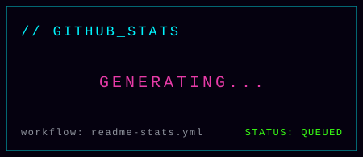
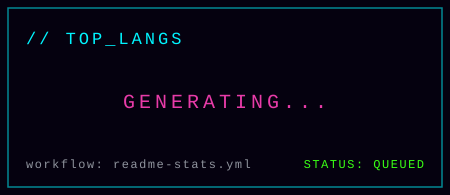

 

 

<table width="100%">
<tr><td>

### 👾 About Me

I'm a **Full Stack Developer** who enjoys turning ideas into real, production-ready systems — from crafting interfaces to building the APIs and infrastructure behind them.

I care about clean architecture, reliable backends, creative UI, and reproducible dev environments. I like mixing **technology + creativity + gaming culture** into what I build.

</td></tr>
</table>

 

### ⚡ Tech Stack

 

<table width="100%" align="center">
<tr>
<td width="50%" valign="top" align="center">

**🧩 What I build**
- ⚔️ Full stack applications
- 🧠 Complex systems, simplified
- 🗺️ APIs & data flows
- 🎨 Interfaces with personality
- 🐳 Containerized dev environments

</td>
<td width="50%" valign="top" align="center">

**🔭 Currently exploring**
- Better software architecture
- Modern full-stack development
- Interactive web experiences
- AI-assisted dev workflows
- Reproducible container setups

</td>
</tr>
</table>

 

### 📊 GitHub Stats

<table align="center">
  <tr>
    <td align="center" width="50%">
      
    </td>
    <td align="center" width="50%">
      
    </td>
  </tr>
</table>

 

### 🌐 Connect

© Finaritriniaina Manantsoa · Built with code, curiosity & a little chaos.

